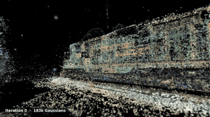
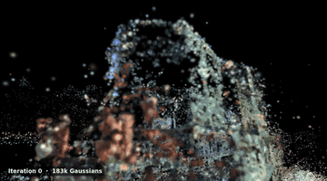
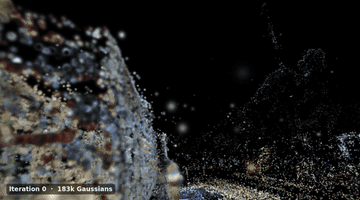
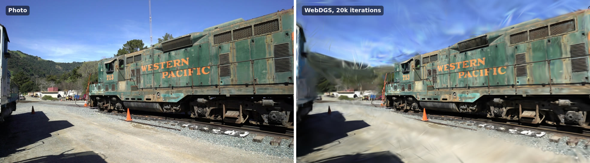

# WebDGS

Differentiable Gaussian Splatting training and viewing, entirely in the browser with WebGPU. This is a full pipeline implemented as a static site: load data, train, densify and prune, and render the evolving point cloud live, all on the GPU.

Live demo: [https://krispy-kenay.github.io/WebDGS/](https://krispy-kenay.github.io/WebDGS/)

<p align="center">
  
</p>

| Side view | Front view | Cab close-up |
| --- | --- | --- |
|  |  |  |

*Training progress from iteration 0 (the sparse COLMAP point cloud) to 20k iterations; the overlay shows the iteration and Gaussian count.*



*Left: training photo. Right: WebDGS at 20k iterations, same camera.*

Higher-quality MP4/WebM versions and a machine-readable manifest live in [`showcase/`](showcase/README.md).

<details>
<summary>Quick facts</summary>

| What | Details |
| --- | --- |
| Stack | TypeScript + WebGPU + WGSL (Vite) |
| Runs | Local dev server or static hosting |
| Data | COLMAP outputs (images.bin + cameras.bin or JSON) and PLY splats |
| Modes | Train new splats or view existing ones |
| Focus | Real-time, GPU-first differentiable rendering in the browser |

</details>

## What this is
WebDGS is a browser-native implementation of a Gaussian Splatting training loop. It includes tiled forward rendering, rasterization, backward gradients, Adam updates, and a densify/prune schedule, all running on the GPU via WebGPU compute passes. The goal is to make 3DGS training understandable and interactive: you can load a dataset, tweak training parameters, and see how the scene evolves without leaving the browser.

This repo is built as a static site. There is no backend service and no server-side ML framework. Everything happens client-side, which makes it easy to host and share, but also means the pipeline is constrained by browser and GPU limits. If you are reviewing this as engineering work, the interesting parts are the GPU pipeline structure, buffer management for dynamic point counts, and the UI-driven training loop that stays interactive while doing real compute.

## Why it matters
Most 3DGS pipelines live in native code and require specialized environments. WebDGS demonstrates that the full training loop can be moved to the browser, opening the door to interactive education, lightweight demos, and portable research tooling. It also shows how to structure a non-trivial GPU workload in TypeScript and WGSL without losing performance or developer ergonomics.

## Running locally
Install dependencies and start the dev server:

```bash
npm install
npm run dev
```

Build and preview a production bundle:

```bash
npm run build
npm run preview
```

The app is a static site, so the build output can be hosted anywhere that serves files (GitHub Pages, Vercel, Netlify, or a custom server).

## Browser requirements
You’ll need a WebGPU-enabled browser (a recent Chromium-based build is the safest bet). A discrete GPU is strongly recommended for larger scenes.

## Data and workflows
WebDGS supports two primary workflows. You can load a prebuilt PLY splat (or a COLMAP `points3D.bin` as the initial point cloud) for instant viewing, or you can load COLMAP outputs and train directly in the browser. For COLMAP data, provide the images folder and the camera metadata. The loader accepts the standard `images.bin` and `cameras.bin` files, or a JSON camera file if you have custom preprocessing.

Once data is loaded, you can start training from the UI. The training controls expose the iteration budget, densify and prune schedule, and the key loss weights. Training progress, iteration rate, and the current Gaussian count update live while the scene renders.

The file-type detection is intentionally simple: it looks at the filename and the first bytes, then falls back to a best-effort loader.

```ts
// src/utils/load.ts
const isPly = headerView[0] === 0x70 && headerView[1] === 0x6c && headerView[2] === 0x79; // 'ply'

if (isPly || filename.endsWith('.ply')) {
  return loadPointCloud(file, device);
}

// Bin check / JSON check
if (filename.endsWith('points3d.bin')) {
  return loadPointCloud(file, device);
}
else if (filename.endsWith('cameras.bin') || filename.endsWith('images.bin') || filename.endsWith('.json')) {
  return loadCamera(file);
}
```

## User experience
The UI is designed to feel more like a live lab bench than a static viewer. Training and viewing are both real-time. You can toggle Gaussian vs point-cloud rendering, adjust Gaussian scale and point size, and track the densify schedule in the control panel. The intent is to make the training loop legible: you can literally see how the representation changes as it optimizes.

## Technical outline
At a high level, training repeatedly renders the current Gaussians from one or more camera views, computes a loss against the reference images, backpropagates gradients into Gaussian parameters, and applies an optimizer update. On a schedule, the system densifies (clone/split) and prunes (drop low-value Gaussians) to keep capacity where it matters.

The implementation is GPU-first. Forward and backward passes are tiled for efficiency, tile entries are ordered by a deterministic GPU radix sort, gradients are accumulated in 64-bit fixed point, and densify/prune is executed with multiple compute stages, including a GPU-side scatter that compacts and expands the Gaussian buffers. The October 2026 update (FastGS-style densification with opacity reset, an exact D-SSIM gradient, the portable sort, the wider accumulators and tile-overflow handling) is described below.

### Shader integration
WGSL is imported directly as source strings via a Vite plugin, so pipelines can be built without custom bundling steps.

```ts
// vite.config.ts
rawPlugin({
  fileRegex: /\.wgsl$/,
})
```

In code, that means renderers can import WGSL like any other module:

```ts
// src/renderers/densify-prune.ts
import decideWGSL from '../shaders/densify-prune-decide.wgsl';
import scatterGaussiansWGSL from '../shaders/densify-prune-scatter-gaussians.wgsl';
```

### Densify and prune (FastGS-style, GPU rebuild)
Densification follows the FastGS recipe. A Gaussian becomes a densify candidate when it is important in enough sampled training views: `metricViews` views are rendered at `1/metricDownscale` resolution, each view's per-pixel L1 error is normalised to [0, 1] and thresholded at `metricThreshold`, and a Gaussian whose footprint hits high-error pixels in at least `cloneThresholdCount` views qualifies. Candidates are then gated by their accumulated view-space gradients since the last densify step, and the decision between clone and split is relative to the scene extent rather than a fixed world-space size. Gaussians whose opacity falls below `pruneOpacity` are pruned. Every `opacityResetInterval` iterations (while densifying) all opacities are capped at 0.01 so floaters fade out and get pruned, and after the first reset Gaussians larger than `pruneScaleFraction` of the scene extent are pruned as well.

```ts
// src/trainer.ts
this.densifyPruneConfig = {
    schedule: {
        enabled: true,
        warmupIterations: 500,
        interval: 100,
        stopIterations: 15_000,
    },
    metricViews: 10,
    metricDownscale: 2,
    maxBufferBytes,
    maxNewPointsPerStep: 5000,
    // FastGS defaults
    metricThreshold: 0.1,
    pruneOpacity: 0.005,
    cloneThresholdCount: 6,
    splitScaleFraction: 0.001,
    gradThreshold: 0.0002,
    gradAbsThreshold: 0.0012,
    opacityResetInterval: 3000,
    pruneScaleFraction: 0.1,
};
```

The scene extent is computed the 3DGS way, from the spread of the training camera centres, and the split threshold is a fraction of it, so the same defaults work for scenes at any scale:

```ts
// src/trainer.ts
// 3DGS scene extent
function sceneExtent(cameras: CameraData[]): number {
    const centers = cameras.flatMap((c) => (c.position ? [c.position] : []));
    if (centers.length === 0) return 1;
    const mean = [0, 1, 2].map((i) => centers.reduce((sum, c) => sum + c[i], 0) / centers.length);
    const maxDist = Math.max(...centers.map((c) => Math.hypot(c[0] - mean[0], c[1] - mean[1], c[2] - mean[2])));
    return maxDist > 0 ? 1.1 * maxDist : 1;
}
```

```ts
// src/trainer.ts
private syncDensifyPruneConfig(): void {
    const c = this.densifyPruneConfig;
    this.densifyPrune.setConfig({
        numViews: c.metricViews,
        maxBufferBytes: c.maxBufferBytes,
        maxNewPointsPerStep: c.maxNewPointsPerStep,
        pruneThreshold: c.pruneOpacity,
        cloneThreshold: c.cloneThresholdCount,
        splitThreshold: c.splitScaleFraction * this.sceneExtent,
        gradThreshold: c.gradThreshold,
        gradAbsThreshold: c.gradAbsThreshold,
    });
}
```

On the GPU, the decide pass applies the gradient gate: a small Gaussian (clone) needs a large mean gradient, a large one (split) needs a large mean absolute gradient. The backward pass accumulates both, plus a visibility count, into `densify_stats` between densify steps.

```wgsl
// src/shaders/densify-prune-decide.wgsl
} else if (count >= cfg.clone_threshold_count) {
  // Decide clone vs split by 3D scale magnitude.
  let s0 = unpack2x16float(g.scale[0]);
  let s1 = unpack2x16float(g.scale[1]);
  let scale3 = exp(vec3<f32>(s0.x, s0.y, s1.x));
  let max_scale = max(scale3.x, max(scale3.y, scale3.z));
  let split = max_scale > cfg.split_scale_threshold;

  var grad_ok = true;
  if (cfg.use_grad_stats != 0u && idx < arrayLength(&densify_stats)) {
    let s = densify_stats[idx];
    let steps = max(s.z, 1.0);
    grad_ok = select(s.x / steps >= cfg.grad_threshold, s.y / steps >= cfg.grad_abs_threshold, split);
  }

  if (grad_ok) {
    action = select(1u, 2u, split);
    out_count = 2u;
  }
```

A prefix scan over the per-Gaussian output counts gives every survivor its slot, and the scatter stage writes the new packed Gaussian buffer (and the matching SH and optimizer state) from the old buffer and the action/count stream:

```wgsl
// src/shaders/densify-prune-scatter-gaussians.wgsl
@compute @workgroup_size(256)
fn scatter_gaussians_main(@builtin(global_invocation_id) gid: vec3<u32>) {
  let idx = gid.x;
  if (idx >= info.in_points) {
    return;
  }

  // Keep layout stable even if actions not used yet.
  let _act = select(0u, out_actions[idx], idx < arrayLength(&out_actions));
  if (_act == 123456u) { }

  let c = out_counts[idx];
  if (c == 0u) {
    return;
  }
  let off = out_offsets[idx];
  if (off >= info.out_points) {
    return;
  }

  // slot 0
  copy_point(off, idx, 0u, _act);

  // slot 1
  if (c == 2u) {
    let off1 = off + 1u;
    if (off1 < info.out_points) {
      copy_point(off1, idx, 1u, _act);
    }
  }
}
```

### Deterministic, portable radix sort
Tile entries (tile id in the high bits, depth in the low bits) are ordered with a stable LSD radix sort in `src/sort/radix_sort_dynamic.wgsl`: 4-bit digits, 8 passes, each pass a per-block digit histogram, an exclusive prefix scan of the counts (`src/prefix`, which now handles inputs of any size), and a scatter that places each key by its stable rank within its block. No workgroup waits on another and nothing relies on subgroup lockstep, so the result is identical on every WebGPU implementation and from run to run. Block dispatches are spread over two dimensions to stay inside `maxComputeWorkgroupsPerDimension`.

### 64-bit fixed-point gradient accumulators
WGSL has no float atomics, so per-Gaussian gradients from many pixels are summed as fixed-point integers. Each accumulator is a 64-bit value split into two `atomic<u32>` words with a manual carry, which removes the overflow that a single 32-bit word hits on large or high-gradient scenes while keeping the sum order-independent (deterministic):

```wgsl
// src/shaders/common.wgsl
// Atomic Float Utilities (Fixed Point)
const GRAD_SCALE: f32 = 1000000.0;

struct FixedPoint64 {
    lo: atomic<u32>,
    hi: atomic<u32>,
};

fn atomicAddFloat(acc: ptr<storage, FixedPoint64, read_write>, value: f32) {
    let scaled = value * GRAD_SCALE;
    var add_lo: u32;
    var add_hi: u32;
    if (abs(scaled) < 2147483648.0) {
        let fixed_val = i32(scaled);
        add_lo = bitcast<u32>(fixed_val);
        add_hi = select(0u, 0xFFFFFFFFu, fixed_val < 0);
    } else {
        let hi_f = floor(scaled / 4294967296.0);
        add_lo = u32(scaled - hi_f * 4294967296.0);
        add_hi = bitcast<u32>(i32(hi_f));
    }
    let old_lo = atomicAdd(&(*acc).lo, add_lo);
    add_hi += select(0u, 1u, old_lo > 0xFFFFFFFFu - add_lo);
    if (add_hi != 0u) {
        atomicAdd(&(*acc).hi, add_hi);
    }
}
```

### Safe tile-overflow handling
The number of (Gaussian, tile) entries is only known on the GPU after the prefix scan. The sort buffers start at about 10 entries per Gaussian and are capped by the device's `maxBufferSize` / `maxStorageBufferBindingSize` (which are now requested from the adapter at device creation). If a frame needs more entries than fit, the emit pass drops the excess instead of writing out of bounds, the stats pass clamps the count it hands to the sort, and the requested count is read back after the frame so `syncCapacity()` can grow the buffers before the next one:

```wgsl
// src/shaders/tiled-forward.wgsl
            // Entries beyond the sort buffers are dropped
            if (key_idx < tile_info.max_tile_entries) {
                tile_keys[key_idx] = make_tile_key(tile_id, depth_ordered);
                tile_indices[key_idx] = idx;
            }
```

### Loss weighting
Training exposes the loss weights directly in the UI (L1, L2, and D-SSIM). The D-SSIM gradient is exact: SSIM uses the usual 11×11 Gaussian window, and two passes in `src/shaders/loss.wgsl` first compute each window's statistics and partial derivatives, then sum them back onto every pixel. It is checked against finite differences, and it is what lets densification find detail in textured regions. The defaults are set in the trainer:

```ts
// src/trainer.ts
this.trainingConfig = trainingConfig || {
  lambda_l1: 0.8,
  lambda_l2: 0.0,
  lambda_dssim: 0.2
};
```

## Architecture notes
The codebase is separated into a small number of focused modules:

`src/trainer.ts` orchestrates the training loop, scheduling, and swaps between point-cloud buffers. `src/renderers` contains the forward pass, rasterizer, backward pass, optimizer, and densify/prune stages. `src/shaders` holds the WGSL kernels that implement the heavy lifting, `src/sort` and `src/prefix` hold the radix sort and prefix scan, while `src/viewer.ts` provides a lighter-weight rendering path for inspection and navigation. The entry point, `src/main.ts`, wires the UI, handles WebGPU initialization, and runs the render loop.

If you are looking for a “tour route” through the code, start with `src/main.ts` (UI + initialization), then read `src/trainer.ts` (the training loop), and then dive into `src/renderers` and `src/shaders`. The densify/prune implementation is one of the more distinctive parts of the repo: it includes a multi-view importance metric, a gradient-gated decision pass, a total/cap pass, and a scatter pass that compacts and expands the Gaussian buffers entirely on the GPU. The training loop also keeps optimizer state in GPU buffers and applies Adam updates without CPU involvement.

## Performance and constraints
Because everything runs in the browser, performance depends heavily on GPU support and driver maturity. Discrete GPUs are recommended for larger scenes, and very large datasets may hit browser memory limits. The app requests the adapter's full buffer limits, grows the tile sort buffers on demand within them, and drops (rather than corrupts) tile entries that would overflow, while keeping intermediate buffers bounded when densifying. Optimizer state is only kept for the colour terms that are actually trained (DC), and densification currently adds at most 5,000 Gaussians per step as a stand-in for a proper memory budget.

## Roadmap

Done in 2026:

- [x] Pair training cameras with photos by file name
- [x] Correct backward gradients for mean, scale and rotation (viewport factor included)
- [x] Render each densify metric view from its own camera
- [x] Densify growth cap no longer deletes surviving Gaussians
- [x] 64-bit fixed-point gradient accumulators
- [x] Prefix scan of any size
- [x] Portable, deterministic radix sort
- [x] Safe tile-entry overflow with on-demand buffer growth
- [x] Request the adapter's buffer limits; optimizer state only for the trained colour terms
- [x] FastGS densification: gradient gating, split relative to scene extent
- [x] Opacity reset and pruning of oversized Gaussians
- [x] Splat radius cap raised from 128 to 336 px
- [x] Exact D-SSIM gradient

Still open:

- [ ] Handle `device.lost` with a visible message instead of a frozen page
- [ ] Out-of-memory-safe densify swap: keep the old point cloud and warn instead of crashing
- [ ] Memory budget for total GPU memory, a visible capacity warning, then remove the 5,000-per-step throttle
- [ ] Keep training photos smaller on the GPU (playroom's photos alone take about 900 MB)
- [ ] Optimizer: position learning rate scaled by scene extent with decay, Adam bias correction
- [ ] Check whether the f16-packed gradients can overflow on large Gaussians
- [ ] Remaining needle artifacts in the sky (models are still several times smaller than the 3DGS reference)
- [ ] Viewer is a few pixels off from the training camera for the same photo
- [ ] Per-tile depth limit (8,192 splats) drops splats silently
- [ ] Faster SSIM (separable blur); skip gradient buffers the densify metric pass never uses
- [ ] Spherical harmonics above degree 0 (view-dependent colour)
- [ ] PLY export of the trained model and a "view trained result" button
- [ ] Example dataset with a "load example" button
- [ ] Evaluate on held-out views instead of training views
- [ ] Add a license

## Notes on scope
WebDGS is intentionally end-to-end rather than a minimal viewer. The “interesting work” is spread across GPU compute (forward/backward, scatter, sorting), GPU memory layout and resizing for dynamic point counts, and the UI/runtime structure needed to keep training interactive in a browser app.

## Contributing and collaboration
If you want to extend this project, contributions are welcome. Areas that are particularly interesting include performance tuning, additional loss terms, improved camera and dataset loaders, and UI additions for analysis or debugging. Open a discussion or PR if you want to collaborate.

## Acknowledgments
This project is inspired by the 3D Gaussian Splatting literature and open-source differentiable rasterization work. Several shader routines follow established approaches from prior art in the community.
